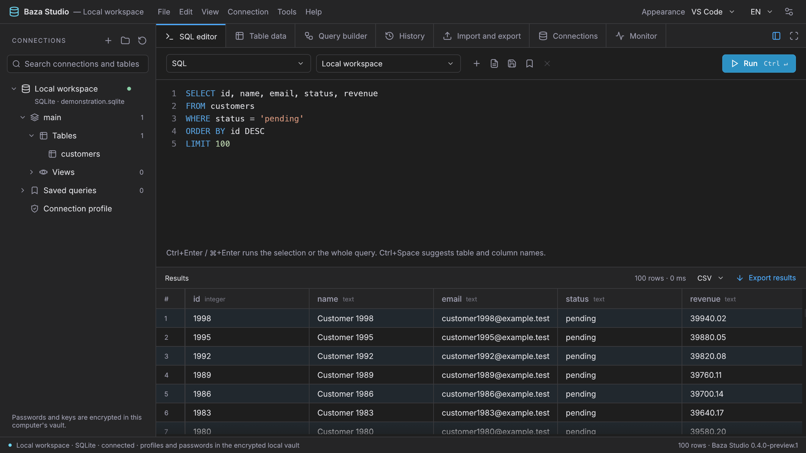
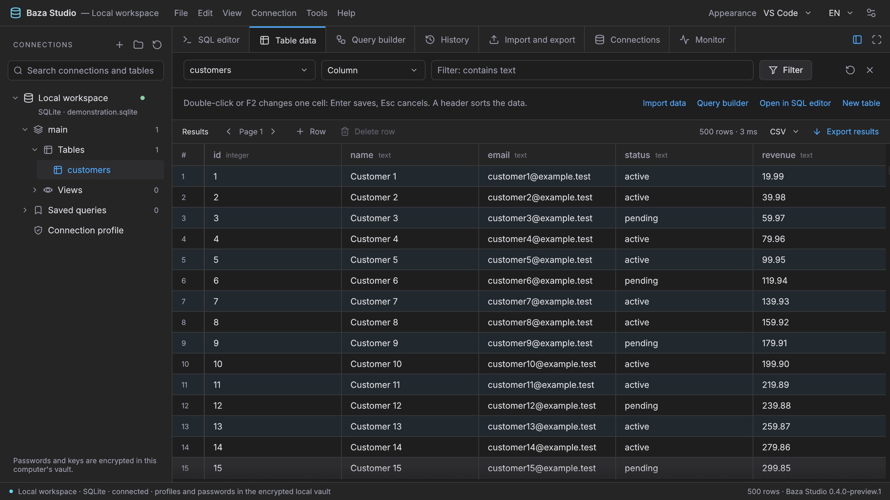
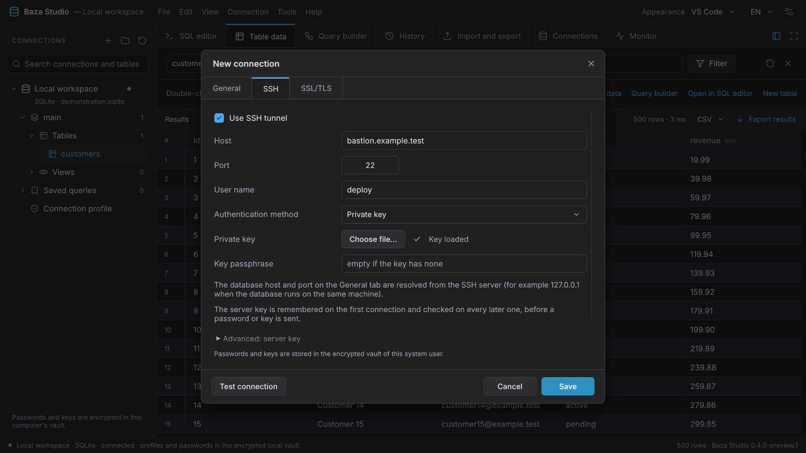
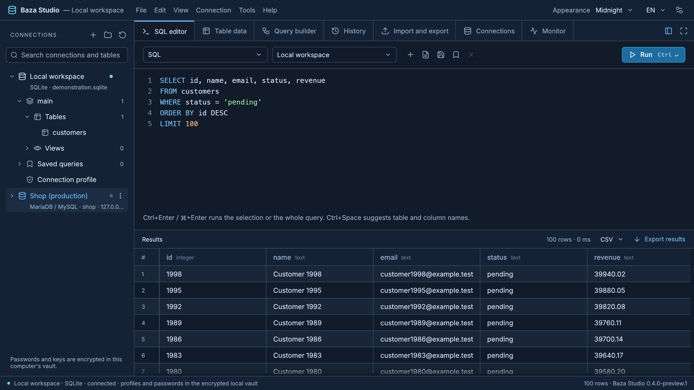

# Baza Studio

[](docs/media/baza-studio-promo.mp4)

[Watch the full film](docs/media/baza-studio-promo.mp4) (MP4, 46 seconds, no sound)

Baza Studio is a native desktop database client for Windows and macOS. It speaks to relational databases (PostgreSQL, MySQL / MariaDB, SQLite, Microsoft SQL Server, Oracle), analytical ones (ClickHouse, DuckDB), key-value and document stores (Redis, MongoDB, Cassandra, Amazon DynamoDB) and search engines (Elasticsearch, OpenSearch), plus the cloud services built on them. It is written in Rust and draws its own window with egui and wgpu: there is no Electron, no WebView and no browser engine inside, and it runs without a Python server or Docker. All of its code is in `native/`. The program is free software under GPL-3.0-or-later and is an early preview (0.4.0-preview.1).

## Supported databases

| Family | Products | Checked against a live server |
| --- | --- | --- |
| PostgreSQL | PostgreSQL, TimescaleDB, CockroachDB, YugabyteDB, Greenplum, Amazon RDS / Aurora, Amazon Redshift, Azure, Google Cloud SQL, Supabase, Neon | PostgreSQL 17, TimescaleDB, CockroachDB |
| MySQL | MySQL, MariaDB, Percona, TiDB, PlanetScale, SingleStore, OceanBase, Amazon RDS / Aurora, Azure, Google Cloud SQL | MySQL 8.4, MariaDB 11, TiDB |
| SQLite | SQLite | yes |
| SQL Server | Microsoft SQL Server, Azure SQL Database, Azure SQL Managed Instance, Amazon RDS for SQL Server, Azure SQL Edge | Azure SQL Edge (SQL Server 2019 engine) |
| Oracle | Oracle Database, Autonomous Database, Amazon RDS for Oracle, Oracle Database Free | Oracle Database 23ai Free |
| ClickHouse | ClickHouse, ClickHouse Cloud | ClickHouse 26 |
| DuckDB | DuckDB (embedded; also queries CSV, Parquet and JSON files) | DuckDB 1.5 |
| Redis | Redis, Valkey, KeyDB, Dragonfly, Amazon ElastiCache / MemoryDB, Azure Cache, Google Memorystore, Upstash | Redis 8, Valkey 8 |
| MongoDB | MongoDB, MongoDB Atlas, Amazon DocumentDB, Azure Cosmos DB for MongoDB, FerretDB | MongoDB 8 |
| Cassandra | Apache Cassandra, ScyllaDB, Amazon Keyspaces, Azure Managed Instance for Apache Cassandra | Cassandra 5 |
| DynamoDB | Amazon DynamoDB, DynamoDB Local, ScyllaDB Alternator | DynamoDB Local |
| Search | Elasticsearch, OpenSearch, Amazon OpenSearch Service, Elastic Cloud | OpenSearch 2.19, Elasticsearch 7, 8 and 9 |

Products that are not in the last column are presets of a verified driver (default port, TLS and notes) and have not been connected to; differences of those services may still surface. What each engine supports (SQL editor or command console, editing, designer, query builder, monitor) is declared per engine, and the interface adapts to it. The driver contract and the full verification table are in `native/crates/baza-core/src/drivers/README.md`.

## Features

- **SQL editor** with tabs (a command console for Redis, MongoDB and the search engines). Ctrl+Enter (Cmd+Enter on macOS) runs the selection or the whole query; results come back in a typed grid.
- **Workspace layout**: a ribbon of tools on top, and below it the tabs of the work area: Objects, every open table and every table being designed.
- **Objects**: a click on a schema or a folder lists its tables and views, with an information panel (engine, rows, sizes, dates, collation, comment) for the selected one. Select several with Ctrl or Cmd and Shift to open their data, see their structure, copy their names or drop them after a confirmation.
- **Table data**: browse with filter, sort and paging, and change a single cell in place. A change is checked for a conflict before it is written. The bar under the rows adds, deletes, saves and reloads records, moves between pages (first, previous, a typed page, next, last), sets the records per page (up to 20,000, also as the default) and switches between the grid and a one-record form.
- **Spreadsheet-style marking**: drag over cells, click row numbers, Ctrl or Cmd with a column header, Shift to extend, Ctrl+A for the page. The mark copies as tab-separated text (with or without column names), CSV, JSON or INSERT statements; several marked rows are deleted in one go.
- **Keyboard shortcuts** for everything: Ctrl+Q new query, Ctrl+R run, Ctrl+Shift+R run the statement at the cursor, Ctrl+/ comment, Ctrl+F find, Ctrl+G go to a record, Ctrl+D structure, F5 refresh, arrows and Tab in the grid, and more. F1 lists them all.
- **Query builder**, **query history** kept on the computer, and **saved queries**.
- **Import and export** of data (CSV, JSON) and of SQL files.
- **Table designer** and a tree of schemas, tables and views.
- **Connection groups** and a simple **monitor** view.
- **SSH tunnel built into each connection**: an SSH tab in the connection dialog with host, port, user and a password or a private key. No separate tunnel program.
- **TLS** for database connections.
- **Encrypted local vault** for connection profiles and passwords (AES-256-GCM, the key protected by Windows DPAPI or the macOS Keychain), and an optional application lock with a password and TOTP.
- **Five dark themes** (VS Code, the default, Graphite, Midnight, OLED, Amethyst), **a light theme**, and a Polish and English interface.

## Screenshots

| SQL editor and results | Table data |
| --- | --- |
|  |  |

| SSH tab of a connection | Midnight theme |
| --- | --- |
|  |  |

The screenshots, the film and the GIF are real captures of the application working on a sample SQLite database. How they are made is described in [media/promo/README.md](media/promo/README.md).

## Getting Baza Studio

### Download

Preview packages for Windows and macOS are attached to the [releases of this repository](https://github.com/SurMistrz666/BazaStudio/releases). No account is needed. The packages are not yet signed with a publisher certificate and are not notarized by Apple, so Windows and macOS may warn when you open them.

The program works without an account and without any online service. Database credentials and queries go only to your own database servers.

### Build from source

Rust 1.99.0 is required. Windows needs MSVC and the Windows SDK; macOS needs the Xcode Command Line Tools.

```text
cd native
rustup toolchain install 1.99.0 --profile minimal --component rustfmt,clippy
cargo +1.99.0 test --locked --workspace
cargo +1.99.0 build --locked --release --workspace
```

For a standalone Windows release, set `$env:RUSTFLAGS='-C target-feature=+crt-static'` in PowerShell before building, so the package does not need a separate Visual C++ Runtime. The Windows workflow uses the same flag.

`native/scripts/package-windows.ps1` builds the `.exe` and a portable `.zip`, checks the packaged engine and the real GPU renderer, and writes hashes and reports. `native/scripts/package-macos.sh` builds the `.app`, `.app.zip` and `.dmg` on a real Mac of the target architecture, with the same checks. The workflow `native-desktop.yml` runs on `windows-2025`, `macos-15` (Apple Silicon) and `macos-15-intel`.

### Checking a build

Baza Studio has three test modes. None of them uses existing profiles: each works on its own disposable vault and a sample SQLite database.

```text
BazaStudio --self-test --report PATH             engine checks without a window
BazaStudio --native-ui-self-test --report PATH   opens the real GPU window, saves a screenshot, exits
BazaStudio --qa-interactive                      a normal window for testing by hand
```

The tests cover the current system key store, real data, encryption, conflicts, cancellation and the signature protocols. SQLite does not replace separate acceptance on PostgreSQL and MariaDB, or a person using the interface.

The tunnel can be checked against a real SSH server with the test `real_sshd`, which is skipped by default. The server is described by the `BAZA_SSH_TEST_*` variables listed at the top of `native/crates/baza-core/tests/real_sshd.rs`:

```text
BAZA_SSH_TEST_PORT=22 BAZA_SSH_TEST_USER=user BAZA_SSH_TEST_KEY=~/.ssh/id_ed25519 \
BAZA_SSH_TEST_TARGET_PORT=8080 cargo +1.99.0 test --locked -p baza-core --test real_sshd -- --ignored --nocapture
```

The crate `native/crates/baza-qa` builds `BazaQa`: acceptance tools without a window. They are compiled and tested with the workspace but are not part of the packages, and they never open the vault of the program, only a disposable QA vault.

```text
BazaQa --tls-self-test --fixture FILE --report FILE
BazaQa --vault-concurrency-worker --qa-run UUID --report FILE
BazaQa --vault-concurrency-finalize --qa-run UUID --expected-workers N --report FILE
```

`--tls-self-test` checks PostgreSQL and MariaDB TLS through an SSH tunnel on your own test servers: the fixture file names the forwarded local ports, the test account and the CA certificate. `--vault-concurrency-worker`, started in several processes at once with the same UUID, checks the first opening of a vault by many processes; `--vault-concurrency-finalize` verifies the outcome and removes the QA vault with its key.

## Security notes

**Local vault.** Profiles, passwords, the query library and the history are encrypted with AES-256-GCM. On Windows the vault key is protected by DPAPI of the current user and private ACLs. On macOS the key is kept in the login keychain and is written and read through the system tool `security`, so later versions of the program open the same vault without a system prompt. Additional `.sql` copies of the history are optional and off by default. The vault rejects unsafe paths, links, wrong permissions and damaged records.

**Application lock.** Off by default. You can set a local password and, on top of it, TOTP two-factor codes for unlocking the program. It is a local feature, independent of any account. The password uses Argon2id; TOTP rejects a code that was already used, and recovery codes work once. Locking, by hand or automatically, clears the visible data and closes the connections.

**SSH tunnel.** The tunnel is part of the database connection and runs inside Baza Studio. Nobody has to type a server key fingerprint: on the first connection the program remembers the key of the server in the profile (trust on first use), and on every later connection it checks the key before a password or a private key is sent. If the server presents a different key, the connection is stopped with a clear warning, and only a deliberate "Trust the new key" stores the new one; a remembered key is never replaced silently. A fingerprint received from an administrator can be entered, or fetched from the server, under "Advanced". Local ports listen on `127.0.0.1` only. A tunnel lives as long as its database connection is open, or until the SSH connection is lost, has no idle limit and accepts up to 32 connections at a time. Full verification of the database certificate through a tunnel keeps the original host name; a configuration that cannot be verified is refused instead of being weakened.

**Importing and exporting connections.** Import covers the verified formats and encrypted BZX1 packages. A plain export leaves the credentials out.

**Updates.** A check for updates happens only when you ask for it in the "Updates" window. The program then sends one anonymous request to the public GitHub API for the releases of this repository, without a token, cookies or an installation identifier. No answer is an ordinary "could not check" state, not an error. The program does not download or run packages: it shows the newest version, its notes, the size and the SHA256 GitHub reports for the package of your system, opens the release page in the browser, and can compare a file you downloaded with that checksum.

## Project status

Baza Studio is an early preview. Snowflake, BigQuery and other engines, a richer monitor and the remaining feature work are in progress, and the preview packages are neither signed nor notarized yet. Whether a particular build is accepted follows from the reports of that build; a build that finished does not mean the program is finished. Use it on data you can afford to restore.

## License

Baza Studio is free software under the GNU General Public License, version 3 or (at your option) any later version (`GPL-3.0-or-later`). The full text is in [LICENSE](LICENSE). You may use, change and redistribute the program under the terms of that license; whoever distributes a changed version makes its source code available under the same license.

```text
Copyright (C) 2026 SurMistrz666

This program is free software: you can redistribute it and/or modify it under
the terms of the GNU General Public License as published by the Free Software
Foundation, either version 3 of the License, or (at your option) any later
version.

This program is distributed in the hope that it will be useful, but WITHOUT ANY
WARRANTY; without even the implied warranty of MERCHANTABILITY or FITNESS FOR A
PARTICULAR PURPOSE. See the GNU General Public License for more details.
```

Libraries and assets by other authors keep their own licenses: they are listed in `native/THIRD-PARTY-NOTICES.txt` and `native/THIRD-PARTY-INVENTORY.json`, with the original texts in `native/third-party-licenses/`. The modified copies of `sqlx-postgres` and `sqlx-mysql` in `native/vendor/` stay under MIT/Apache-2.0. The Inter typeface in `native/assets/fonts/` is under the SIL Open Font License 1.1.
